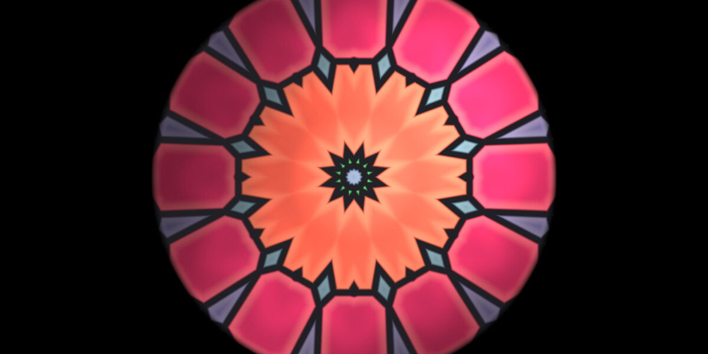
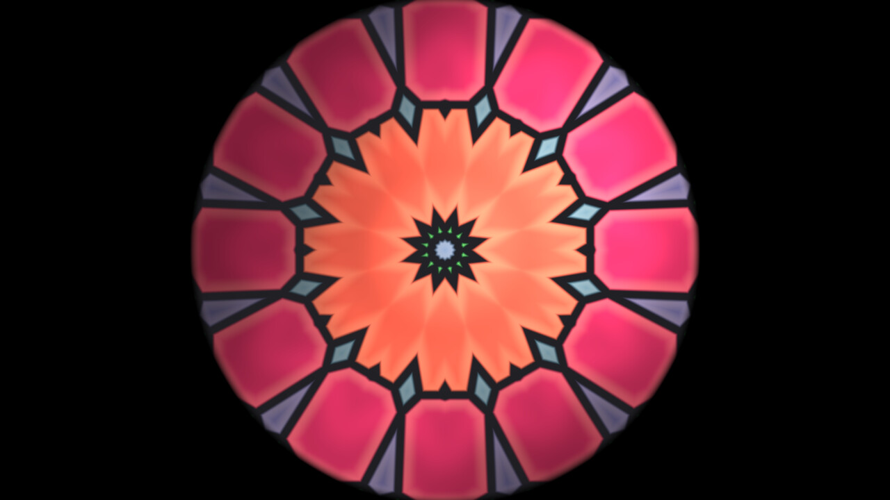

# Vitrail

Live GLSL shaders in the chat, for [Hermes Agent](https://github.com/NousResearch/hermes-agent).

Ask for a visual. Hermes writes a fragment shader, your GPU compiles it before the model
answers, and the shader animates inside the reply with the sliders and colour pickers the model
declared for it.



*Vitrail* is French for a stained-glass window: coloured light, made by hand, one pane at a time.

## What it does

- **A shader is the answer.** "A lagoon at dusk", "a candle flame I can blow on", "a loading
  background for my app": the reply is a live canvas, not a block of code to paste somewhere.
- **The GPU checks the model's work.** In Hermes Desktop, `vitrail_render` hands the shader to
  the Desktop half, which compiles it with WebGL 2 and reports back while the tool call is still
  running. A compile error returns to the model with the driver log and the right line numbers,
  so it fixes the source in the same turn. What reaches you already runs.
- **The model sees what it made.** With the compile verdict comes a still frame of the shader.
  A model with a vision tool can look at it before it answers.
- **Controls without another prompt.** The model annotates uniforms and they become sliders,
  colour pickers and switches under the shader:

  ```glsl
  uniform float speed;  // @slider 0 2 0.6
  uniform vec3 tint;    // @color #ffb060
  uniform bool grain;   // @toggle on
  ```

- **Every surface gets something.** The tool also writes a standalone HTML player. Telegram,
  the CLI and the TUI receive that file; open it in any browser and the shader runs, controls
  included. Hermes Desktop replaces it with the live card.
- **A gallery.** The Vitrail page in the Desktop sidebar keeps every shader Hermes rendered for
  you. Hover a tile to play it, click to open it, copy its GLSL or export a 1920 × 1080 PNG.
- **Heavy shaders stay polite.** One WebGL context serves every shader on screen, shaders
  off-screen are not drawn, and a shader too heavy for the GPU drops to a lower resolution
  instead of stalling the app.

| | | |
|---|---|---|
|  |  |  |
| [`examples/vitrail.frag`](examples/vitrail.frag) | [`examples/lagoon.frag`](examples/lagoon.frag) | [`examples/lumignon.frag`](examples/lumignon.frag) |

## Install

```bash
hermes plugins install elomkdn/vitrail
hermes plugins enable vitrail
```

Then, in Hermes Desktop, switch on **Vitrail** under **Capabilities → Plugins** (desktop halves
ship off by default) and start a new chat.

## Try it

- *A shader of a lagoon at dusk, with sliders for the sun and the swell.*
- *A stained-glass rose window with light moving behind it.*
- *Make it warmer and slow it down.* (Or just move the sliders.)
- *An animated background for a login page, dark, with one accent colour I can pick.*
- *Show me my shaders.* / *Remix the lagoon one into a storm.*

## The shader contract

Shaders are GLSL ES 3.00 in the Shadertoy form:

```glsl
void mainImage(out vec4 fragColor, in vec2 fragCoord) {
  vec2 uv = fragCoord / iResolution.xy;
  fragColor = vec4(uv, 0.5 + 0.5 * sin(iTime), 1.0);
}
```

Vitrail adds `#version`, the precision, `main()` and the built-in uniforms: `iResolution`,
`iTime`, `iTimeDelta`, `iFrame` and `iMouse` (drag on the shader). Shaders are procedural: no
textures and no `iChannel` inputs. The bundled skill `vitrail:shader-studio` gives the model
recipes for noise, palettes, domain warping and SDF raymarching.

## Tools

| Tool | What it does |
|---|---|
| `vitrail_render` | Checks, saves and shows a shader. Returns the GPU verdict when Desktop is open. |
| `vitrail_library` | Lists saved shaders, or returns one shader's source and GPU report by id. |

Two hooks (`post_tool_call`, `transform_llm_output`) make sure a reply delivers the shader the
tool saved during its turn, even when the model forgets the `MEDIA:` line.

## What Vitrail does on your machine

- **No network calls.** Nothing is fetched or sent anywhere by the plugin.
- **No shell commands, no credentials, no telemetry.**
- **GLSL written by the model runs on your GPU**, in the Desktop window, through WebGL 2 (the
  same sandbox a web page gets). Shaders have no inputs besides time, pointer and the controls.
- **Files** are written only under the plugin's data folder
  (`<hermes home>/plugin-data/vitrail/`): one folder per shader with its source, a standalone
  HTML player, the GPU report, a 640 × 360 JPEG still and the PNGs you export.
- **The still frame's path is given to the model.** If the model opens it with a vision tool,
  that image goes to your model provider like any other image.
- **While a Desktop window is open** its Vitrail half calls the plugin's own local route
  (`/api/plugins/vitrail/hello`) once a minute, so the tool knows a GPU is listening.
  `vitrail_render` then waits up to 6 seconds for the verdict. With no Desktop window it does
  not wait and says the shader is not verified.

## Requirements and limits

- Hermes Agent 0.23.0 or later. The live card needs a Hermes Desktop with tool media renderers;
  older builds and other surfaces show the standalone HTML player.
- A GPU with WebGL 2 (any machine that runs Hermes Desktop).
- GPU verification needs a Desktop window connected to the same Hermes that runs the agent.
- One pass per shader: no textures, buffers or audio inputs.

## Tests

```bash
python tests/test_engine.py
```

The tests cover the static checks, the control annotations, the store, the tool handlers (with
and without a GPU verdict), the delivery hooks and that `register()` matches `plugin.yaml`.

## Licence

MIT. By [Elom](https://github.com/elomkdn).
